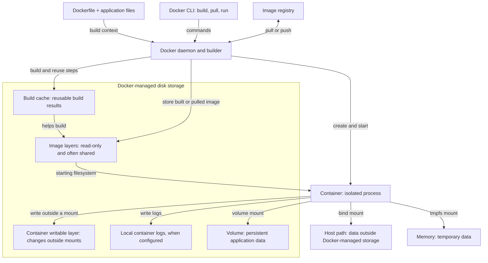

# How Docker works and where its disk space goes

Docker runs applications in **containers**. An **image** supplies a container's
starting files and configuration; the container adds its own changes while it
runs. The Docker client sends commands to the Docker daemon, which builds
images, creates containers, and manages their storage. A registry is a place to
download or publish images. [Docker's overview](https://docs.docker.com/get-started/docker-overview/)

## Follow the flow

1. A `Dockerfile` describes the base image and build steps. `docker build`
   sends it and the build context to the builder. The builder can reuse cached
   results from earlier builds and produces an image. `docker pull` gets an
   already built image from a registry instead. An image can have multiple
   tags, which are names for it, without storing a full new copy for each tag.
   [Dockerfile guide](https://docs.docker.com/build/concepts/dockerfile/) ·
   [Build cache guide](https://docs.docker.com/get-started/docker-concepts/building-images/using-the-build-cache/)
2. Images contain read-only layers. Images that share a base can share those
   layers on disk. `docker run` creates a container from an image and starts its
   process. Each container gets its own writable layer for file changes made
   outside mounts; the original image stays unchanged. The container can stop
   while its writable data remains on disk until the container is removed.
   [Image layers](https://docs.docker.com/get-started/docker-concepts/building-images/understanding-image-layers/) ·
   [Container storage](https://docs.docker.com/engine/storage/drivers/)
3. A container can instead write through a **volume** managed by Docker, a
   **bind mount** pointing to a host path, or a **tmpfs mount** held in memory.
   A volume can outlive every container that used it. Removing a container does
   not mean its volume or bind-mounted files are disposable.
   [Docker storage](https://docs.docker.com/engine/storage) ·
   [Persisting container data](https://docs.docker.com/get-started/docker-concepts/running-containers/persisting-container-data/)

On Linux, Docker's data directory is commonly `/var/lib/docker`, but its
location is configurable. With the newer containerd image store, image content
and container snapshots may be under `/var/lib/containerd` instead. Docker
Desktop can keep Docker data inside a virtual machine. Treat the path shown by
the daemon as information, not as a directory to clean by hand.
[Daemon storage locations](https://docs.docker.com/engine/daemon)

## What uses disk, and what happens if you remove it?

| Storage | Why it grows | What removal changes | Review level |
| --- | --- | --- | --- |
| **Build cache** | Repeated builds keep reusable results. | Old, unused results can be rebuilt; the next build may take longer. | Usually the first cleanup candidate. Preview an age cutoff. |
| **Images** | Pulls and builds leave image layers and old versions behind. | An unused image may have to be pulled or rebuilt later. Shared layers remain while other images need them. | Review names, tags, and future use. `0 containers` alone is not enough. |
| **Containers** | Each container has a writable layer; local logs can grow too. | Removing a stopped container loses its writable changes, logs, and container configuration. The image remains. | Review application state and logs before removal. |
| **Volumes** | Databases, uploads, and other persistent application data accumulate. | Removing a volume deletes its stored data, even if no container currently uses it. | Careful review and a verified backup if the data matters. |
| **Bind mounts** | A container writes directly into a host directory or drive. | Removing Docker objects does not remove that host data. | Review through the owning application or host path; it is outside Docker cleanup. |
| **tmpfs mounts** | A container keeps temporary files in memory. | Data disappears when the container stops. | No persistent disk cleanup. |

Container size figures often describe the **writable layer**, not every byte a
container is responsible for. Local logs, volumes, bind mounts, and other
metadata may be outside that figure. A large container log can therefore help
explain a gap between Docker's category cards and filesystem usage.
[Docker's container size explanation](https://docs.docker.com/engine/storage/drivers/#container-size-on-disk)

## Reading coldshelf's Storage page

- **Primary filesystem** shows the operating system's capacity for the
  filesystem containing your home directory. If Docker data lives on that
  filesystem, it is already included in the used-space number. A folder scan
  may be partial because it cannot read root-owned paths or skips mounts.
- **Docker cards** show Docker's images, containers, volumes, and build cache.
  Do not add their sizes together or add them to filesystem used space: image
  layers and cache can overlap, and folder totals may include Docker data.
  “Reclaimable” is an estimate, not a guaranteed increase in free space.
- An image row's **size** includes shared layers. **Unique** means the portion
  Docker reports as used only by that image at measurement time. Several tags
  in one row name one image. **Untagged** only means no tag is displayed.
  **0 containers** means no existing container references the image; it says
  nothing about whether a future run or build needs it. See
  [Docker's `system df` definitions](https://docs.docker.com/reference/cli/docker/system/df/).
- The image card's reclaimable figure comes from Docker's category summary.
  Coldshelf computes a cleanup preview for selected images by adding their
  reported unique sizes. Those numbers can differ; neither is a promise of
  bytes freed. The list is paginated, and **Select all eligible** spans every
  page, so inspect the reviewed selection before confirming.

For example, if two images each show 6 GiB but share 4 GiB of layers, they
occupy about 8 GiB together, not 12 GiB. Removing only one still leaves the
shared 4 GiB for the other. Other Docker data can affect the space actually
returned to the filesystem.

## A practical cleanup order

1. Refresh Storage. If you use the CLI, `docker system df -v` and `docker ps -a`
   are read-only ways to inspect Docker's accounting and container status.
2. Review **unused build cache** with a conservative cutoff, such as 90 days.
   Coldshelf also offers 30 and 7 days. Its cache preview is an estimate because
   Docker has no true build-cache dry run.
3. Review **stopped containers** individually. Check whether their writable
   changes or logs are needed before removing them.
4. Review **unreferenced images** by name and tag. Consider whether a project
   needs the image soon and whether you can pull or rebuild it. Removing one
   image may free less space than its displayed size because layers are shared.
5. Treat **volumes** as application data. Check what created each one and
   whether a recoverable copy exists. An unlinked volume is eligible in
   coldshelf, but eligibility does not mean its contents are unimportant.
6. Refresh the primary filesystem figure after each cleanup to see actual
   space freed. Do not delete files directly from Docker's data directories;
   let Docker manage its own storage.

In coldshelf, each Docker category is reviewed separately. Only stopped
containers, images with no container references, and unlinked local volumes
are selectable. Cache cleanup uses an age cutoff. A server-owned preview,
typed confirmation, and 10-second cancellation window precede a dashboard
cleanup. Once execution starts, Docker removals cannot be undone. See the
[dashboard workflow](../../README.md#web-dashboard) for details.
